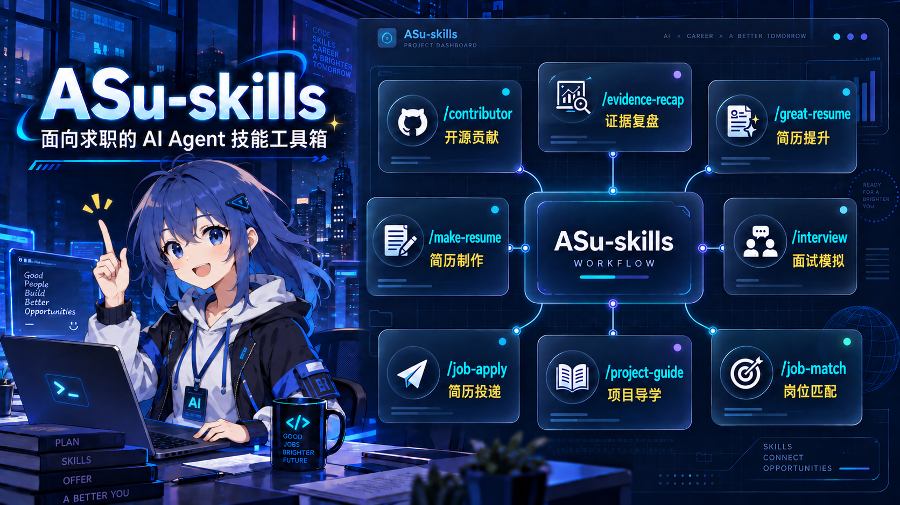
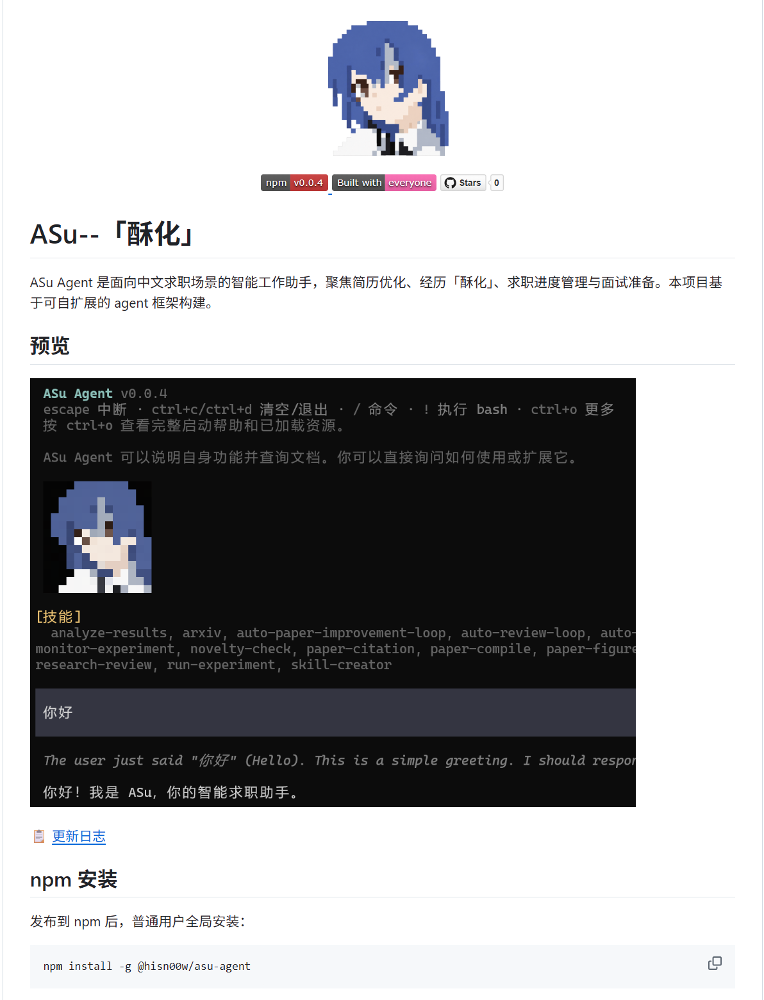
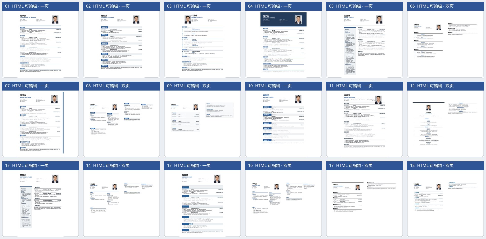
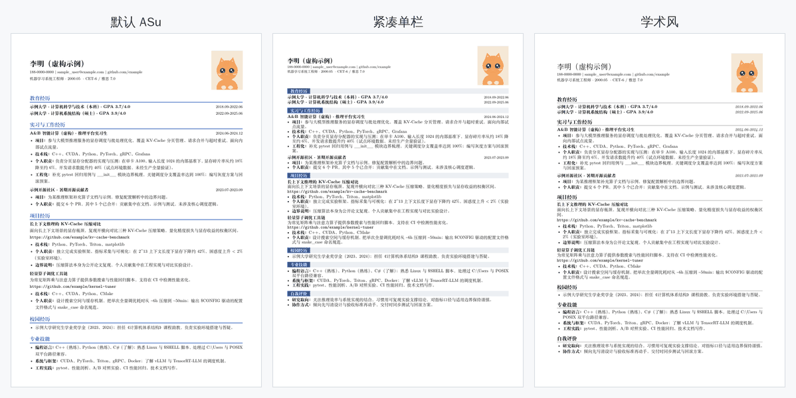
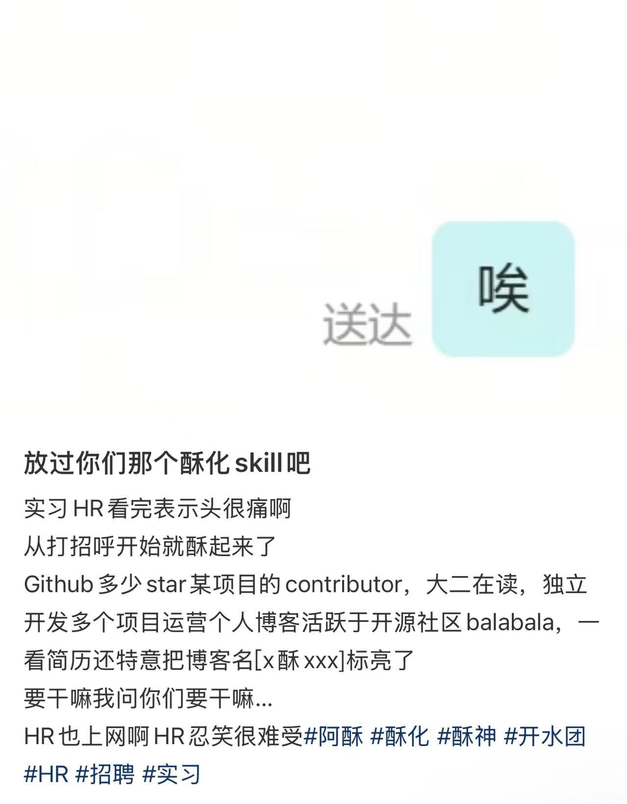
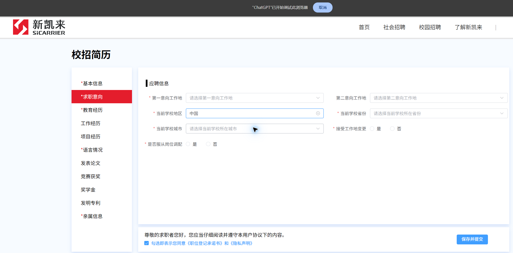

# resume-skills


<div align="center">
  
  <h3>A resume & job-search skill pack for Chinese job seekers</h3>
  <p>Four standalone entry points for resume improvement, resume building, job-match analysis, and job-application autofill.</p>
</div>


<div align="left">
  <a href="README_en.md">English</a> | <a href="README.md">中文</a> | <a href="https://github.com/Wjdz-03/resume-skills">Repository</a>
</div>

<br>

<div align="center">
  <a href="LICENSE"></a>
  <a href="https://deepwiki.com/Wjdz-03/resume-skills"></a>
</div>

<p align="center">
  
  <br>
  <sub>Selected entries are shown here; see below for the complete list of four.</sub>
</p>

> **Acknowledgment / License**: This project is a secondary development based on [Hisn00w/ASu-skills](https://github.com/Hisn00w/ASu-skills) (MIT). Thanks to the original author Hisn00w; the MIT license text is preserved in [LICENSE](LICENSE).

## Contents

- [Harness Project Update](#a-harness-project-update)
- [Installation](#installation)
- [First time: where to start](#first-time-where-to-start)
- [Four skills](#how-the-four-entries-work-together)
  - [`/great-resume`: Improve your experience](#great-resume-improve-your-experience)
  - [`/make-resume`: Build a resume](#make-resume-build-a-resume)
  - [`/job-match`: Job-match analysis](#job-match-job-match-analysis)
  - [`/job-apply`: Job-application autofill](#job-apply-job-application-autofill)
- [How the four entries work together](#how-the-four-entries-work-together)
- [Truthfulness boundaries](#truthfulness-boundaries)
- [File structure](#file-structure)
- [Contributing](#contributing)
- [Acknowledgments](#acknowledgments)
- [Contributors](#contributors)
- [License](#license)
- [Star History](#star-history)

## A Harness Project Update

ASu is building a Harness project tailored to the job-search journey. We welcome real application cases, skills, and terminal experiences via Issues and PRs.



[Check out the ASu Harness project on GitHub](https://github.com/Wjdz-03/resume-skills)

<!-- catalog:readme.en.intro:begin -->
ASu-skills is now a plugin pack. Installing it provides four individually callable entry points:

| Entry | Purpose | Primary deliverables |
| --- | --- | --- |
| `/great-resume` | Resume improvement | Role targeting, project bullet rewrites, evidence of results, HR opener |
| `/make-resume` | Resume building | Generates an editable HTML resume from the ASu or a specified template, with PDF export and optional LaTeX source |
| `/job-match` | Job matching | Compares a JD with verified experience and returns an evidence matrix, hard constraints, and an application recommendation |
| `/job-apply` | Job-application autofill | Connects to a browser, fills an application, and stops for review before submission |
<!-- catalog:readme.en.intro:end -->

## Installation

resume-skills works with Codex, Claude Code, DeepSeek Harness Desktop, TraeWork, and Qoder, plus lightweight Cursor, OpenCode, and WorkBuddy bridges. All entry points share the same `skills/`, `assets/`, and `references/`; the entry catalog is maintained in `skills.registry.json` as the single source of truth and is regenerated/reconciled by `npm run sync:skills` (CI checks it with `--check`).

| Platform | Installation entry | After installation | Uninstall |
| --- | --- | --- | --- |
| Codex | Send the GitHub repository link to Codex and ask it to install the plugin | Start a new conversation and choose an entry from the `/` menu | Remove resume-skills from Codex's plugin manager |
| Claude Code | Run `/plugin marketplace add Wjdz-03/resume-skills` and `/plugin install resume-skills@asu` | Run `/reload-plugins` when prompted | Run `/plugin uninstall resume-skills` |
| DeepSeek Harness Desktop | Open the plugin panel, choose **Add plugin**, paste `https://github.com/Wjdz-03/resume-skills.git`, and install it | Enable resume-skills in the plugin panel, then start a new conversation and choose an entry from the `/` menu | Uninstall resume-skills from the plugin panel |
| Cursor | [Read the Skill bridge installation guide](.cursor-skills/install.md) | Start a new Agent chat and type `/` or `/great-resume`, etc. | Remove the skill directories under the project `.cursor/skills/` or user `~/.cursor/skills/` |
| TraeWork | Copy the repository to `~/.trae-cn/plugins/<publisher>/resume-skills/<version>/` | Restart TraeWork and choose an entry from the `/` menu | Delete the corresponding TraeWork plugin directory |
| OpenCode | [Read the installation guide](.opencode-plugin/installation-guide.md) | Restart OpenCode or run `/reload-plugins` | Delete the installed skills and resource directories according to the installation method |
| WorkBuddy | [Read the bridge installation guide](.workbuddy-plugin/install.md) | Restart WorkBuddy or refresh the skill list | Delete the corresponding directory or symlink under `~/.workbuddy/skills/` |
| Qoder | [Read the installation guide](.qoder-plugin/install.md) | Restart Qoder or start a new conversation and choose an entry from the `/` menu | Uninstall with `qodercli plugin uninstall` or delete the plugin directory according to the installation method |

For local checks, tests, and the PR workflow, see the [contributing guide](.github/CONTRIBUTING_en.md).

## First time: where to start

Pick your first entry based on the problem you most need to solve right now:

| Situation | Start with |
| --------- | ---------- |
| Have experience, but unsure how to match it to a target role | `/great-resume` |
| Resume content is settled; need a regular editable resume | `/make-resume` |
| Want to recreate the ASu-style high-density technical resume | `/make-resume` (default template) |
| Have a JD and resume; need to assess fit and evidence gaps | `/job-match` |
| Have a job URL and need to fill its application form | `/job-apply` |

You can also combine entries:

- **Have projects, ready to apply**: use `/great-resume` to align with the target role and improve the wording, then `/make-resume` to generate the resume; it defaults to the ASu template but accepts a specified template;
- **Have a resume and a specific JD, need an application decision**: use `/job-match` to separate verified matches, presentation gaps, and real gaps; hand confirmed presentation gaps to `/great-resume` when rewriting is needed;
- **Ready to fill an application form**: use `/job-apply` with a connected browser for one specific role; come back to `/great-resume` and `/make-resume` whenever the resume needs an update.

## `/great-resume`: Improve your experience

> **Great-resume** — improving your real experience so it reads sharp, confident, and aligned with your target role through strong positioning, strong evidence, and clear expression. Never fabrication.

Suitable for:

- Re-positioning your experience against a target role;
- Translating low-level work like pages, APIs, and data binding into hiring language;
- Rewriting project bullets, resume summaries, and personal introductions;
- Generating HR openers for LinkedIn or Line;
- Preparing interview follow-up questions, evidence checklists, and the boundary between fact and framing.

For best results, provide the target role, job description, current resume, project descriptions, real responsibilities, and measurable outcomes. When information is missing, the skill drafts what it can and marks the gaps with a `【待补】` (“to be filled in”) placeholder — it never invents titles, companies, tech stacks, or numbers.

Typical usage:

```text
/great-resume

Target role: AI Application Engineer
Based on my internship and project experience below, give me a steady framing and a bold framing, rewrite the resume bullets, and draft an opener to send to HR.
```

### Example HR opener


## `/make-resume`: Build a resume

`/make-resume` handles all resume-file deliverables. Unless you specify another template, it uses the ASu single-column high-density technical resume as a read-only master. You can specify a repository template, local HTML, or reference screenshot; it always produces a genuinely editable HTML, never an image of the original embedded in a page.

Supported:

- 18 Chinese HTML templates;(ask ur agent for a English ver if u like :)
- A4 single- or two-page layout;
- In-browser editing of text, photo, fonts, colors, and bold;
- Save the current edits as a local HTML file;
- “Local fonts” reads fonts installed on your system (Chrome 103+, requires browser permission); “Import fonts” loads local font files (TTF/OTF/WOFF/WOFF2) as a supplement;
- Print-to-PDF export;
- Optional LaTeX `.tex` export in three layouts — default ASu, compact, and academic — for continued editing in Overleaf (on request);
- Layout analysis from screenshots: columns, spacing, font size, colors, and pagination;
- Fictional placeholder photos by default; swap in your own for the real resume.

The default ASu template is copied from `assets/asu-resume-template.html` into a user-specific file and is never modified. “I want an ASu-style resume” is handled by `/make-resume`; if you name another template, that template takes precedence.

Typical usage:

```text
/make-resume

Using the education, internship, and project experience I provide, pick a template suited to a back-end developer role, generate an editable HTML resume, and tell me how to export it as PDF.
```

### Template preview



### LaTeX output preview

When you ask for a LaTeX resume or one suited to Overleaf, a `.tex` source file is exported alongside the HTML, ready to compile and fine-tune in Overleaf. Three layouts are available: the default ASu, a compact one for denser content, and an academic one for black-and-white printing. None of them need extra style files or font configuration.

[Overleaf](https://www.overleaf.com/) is the recommended way to compile — no local TeX installation required, three steps:

1. New Project → Blank Project, name it and click Create;
2. Upload the generated .tex file; if the resume uses a photo, upload it to the same project (next to the .tex, keeping the filename unchanged);
3. Top-left File → Settings: set Main document to the uploaded file and Compiler to XeLaTeX, then Recompile.

Below is sample data compiled in all three layouts.



## `/job-match`: Job-match analysis

`/job-match` separates a target JD into hard constraints, core capabilities, and preferred qualifications, then compares each item with the user's verified resume, experience, or claim–evidence ledger. It distinguishes verified matches, presentation gaps, insufficient evidence, real gaps, and unknowns instead of inventing a precise score from keyword overlap.

Its default output includes a requirement–evidence matrix, hard constraints, up to five priority improvements, and an explainable recommendation: apply, apply after adding evidence, apply cautiously, or do not prioritize. The analysis does not edit a resume, fill a web form, or submit an application.

Typical usage:

```text
/job-match

Compare this JD with my resume. For each requirement, identify verified evidence, presentation gaps, and capability gaps, then tell me whether the role is worth applying to. Do not rewrite my resume yet.
```

## `/job-apply`: Job-application autofill

**Important: this project forbids abusing the skills for mass applications, harassing HR, or sending generic, exaggerated opening messages. Use only real experience and tailor communication moderately to the specific role; piling up GitHub stars, over-packaging experience, and sending the result without review can alienate HR and damage the reputation of both the candidate and the project. `/job-apply` is only for one specific application explicitly confirmed by the user; it never bypasses confirmation, submits applications in bulk, or sends unreviewed messages on the user's behalf.**

<div align="center">
  
  <p><em>Negative example: templated and exaggerated opening messages can cause a negative reaction. Do not copy this style.</em></p>
</div>

`/job-apply` uses confirmed resume data to fill one specific recruitment or application form. It supports page inspection, field mapping, text input, dropdowns, resume/portfolio uploads, and a final pre-submission review. It stops before the final submit button by default; asking to “fill my resume” does not imply permission to submit an application.



### Connect a browser with Kimi WebBridge

**Before using `/job-apply`, install and enable a browser-control extension and confirm that it is connected to the corresponding browser-control service.** ASu does not read or fill a recruitment page until the extension and connection have been checked.

To operate a Chrome or Edge browser where you are already signed in, install and enable the official [Kimi WebBridge](https://www.kimi.com/products/kimi-webbridge). It connects a browser extension, a local daemon, and the Chrome DevTools Protocol; login sessions and page content stay on the local machine.

If you use ChatGPT/Codex browser control, you can instead install and enable the [ChatGPT browser extension (Microsoft Edge Add-ons)](https://microsoftedge.microsoft.com/addons/detail/chatgpt/odlomjlbamekndcpllcnffbgeohgkmjh) (the Chrome Web Store listing has been removed; use Edge Add-ons), then follow the browser-control setup shown in the host application. Choose either connection method; installing both is unnecessary.

### Typical usage

```text
/job-apply

Use my confirmed resume to open this job application, fill the fields and resume attachment that can be verified, ask me about anything missing, and stop before submission for my review.
```

The user must handle passwords, SMS/email codes, MFA, passkeys, and CAPTCHAs. ASu separately confirms personal-data input, file uploads, and final submission; it does not read cookies, tokens, or password storage, and does not bypass anti-bot or access controls.

## How the four entries work together

Recommended order:

1. Use `/great-resume` to lock in role targeting from your existing experience, and to improve resume phrasing and HR talking points;
2. Use `/make-resume` to turn the confirmed copy into an editable resume and export PDF;
3. Use `/job-match` to compare a specific JD with verified evidence, hard constraints, and application priority;
4. Use `/job-apply` to connect a browser, fill one specific application, and review it before submission.

You can also state a combined goal in a single request, e.g.: “first use `/great-resume` to improve the experience, then `/make-resume` to generate an HTML resume, and finally `/job-match` to check evidence gaps against the JD”.

When combining multiple entries, when your materials conflict, or when a resume contains strong claims, you can copy [`assets/career-claim-ledger-template.json`](assets/career-claim-ledger-template.json) to set up a claim–evidence ledger. It lets experience improvements and resume files share the same facts, confirmation statuses, and personal boundaries; see [`skills/great-resume/references/claim-evidence-ledger.md`](skills/great-resume/references/claim-evidence-ledger.md) for the detailed rules.

## Truthfulness boundaries

ASu-skills' “great-resume” approach means strong positioning, strong evidence, and clear expression — never fabricated experience. Please keep to these rules:

- Keep real titles, companies, dates, and education;
- Distinguish team results from personal contributions;
- Only use strong wording like “led”, “owned”, or “Owner” when you have the evidence;
- Use verifiable qualitative results when no reliable numbers exist;
- Never write planned work as completed work;
- Never claim AI-generated code as unverified personal capability;
- Never write real names, phone numbers, emails, passwords, verification codes, or recruiting privacy into public skill files.

## File structure

```text
resume-skills/
├── .claude-plugin/
│   ├── plugin.json              # Claude Code plugin manifest
│   └── marketplace.json         # Claude Code plugin marketplace manifest
├── .codex-plugin/
│   └── plugin.json              # Codex plugin manifest
├── .trae-plugin/
│   └── plugin.json              # TraeWork plugin manifest
├── .opencode-plugin/
│   ├── plugin.json              # OpenCode plugin manifest (skills.entries generated from the registry)
│   ├── install-opencode.py      # OpenCode installer (skill list generated from the registry)
│   └── installation-guide.md    # OpenCode manual installation guide
├── .workbuddy-plugin/
│   ├── install.md               # WorkBuddy bridge guide (catalog blocks generated from the registry)
│   ├── install.sh               # macOS / Linux bridge script
│   └── install.ps1              # Windows bridge script
├── .qoder-plugin/
│   ├── install.md               # Qoder installation guide (CLI / Agent methods)
│   └── plugin.json              # Qoder plugin manifest (interface and other metadata)
├── skills.registry.json        # ★ Single source of truth for the entry catalog; run npm run sync:skills after changing it
├── package.json                # DSH plugin pack manifest (bundle patch entry)
├── cordis.patch.yml            # Registers the DSH filesystem skill provider
├── lib/
│   └── index.js                # DSH plugin entry module
├── skills/                     # Every entry directory (one-to-one with skills.registry.json)
│   ├── great-resume/           # /great-resume resume improvement
│   ├── job-apply/              # /job-apply job-application autofill (browser bridge)
│   ├── job-match/              # /job-match job-match analysis
│   └── make-resume/            # /make-resume resume building
├── scripts/
│   ├── sync-skill-catalog.mjs  # ★ Generates/reconciles every entry catalog from the registry (npm run sync:skills)
│   └── kimi-webbridge.mjs      # Kimi WebBridge local HTTP client
├── assets/                     # Templates, images, and example resources
│   ├── asu-resume-template.html # Read-only master for the ASu-style editable resume
│   ├── icons/                   # Personal & general information SVG icons
│   └── logos/                   # LobeHub Icons static SVG logos
├── references/                  # Reference for organizing recruiting emails
├── .github/
│   ├── CONTRIBUTING.md          # Contribution guide
│   ├── CONTRIBUTING_en.md       # English contribution guide
│   └── PULL_REQUEST_TEMPLATE.md # Pull request template
└── README.md
```

## Contributing

Issues and PRs are welcome. See the [contributing guide](.github/CONTRIBUTING_en.md), or browse the repository's [Pull Requests](https://github.com/Wjdz-03/resume-skills/pulls).

When adding, removing, or renaming an entry, first update [`skills.registry.json`](skills.registry.json), then run `npm run sync:skills` to regenerate every plugin manifest, installer, issue template, and the README overview; verify consistency with `npm run sync:skills -- --check`.

## Acknowledgments

Thanks to the following Xiaohongshu(Chinese IG) creators for their public sharing and inspiration:

- [**阿酥在coding**](https://xhslink.cn/m/2LHuLJZ30b2): sharing on Coding interview experience;
- [**Hi Mr Lonely**](https://xhslink.cn/m/3kVQDyUJ6of): sharing on resume presentation and job-search communication.

This plugin has organized, structured, and compliance-adjusted the relevant content and turned it into a reusable job-search workflow.

Thanks to [LobeHub/lobe-icons](https://github.com/lobehub/lobe-icons) for the open-source brand icon resources; following its skill guide, this plugin prefers `@lobehub/icons` and static SVG/CDN assets.

Thanks to [Kimi WebBridge](https://www.kimi.com/products/kimi-webbridge) for the local browser-connection capability that lets `/job-apply` drive a browser you are already signed into via the Chrome DevTools Protocol, keeping login sessions and page content on your machine.

## Contributors

Thanks to everyone who contributes to resume-skills.

<a href="https://github.com/Wjdz-03/resume-skills/graphs/contributors">
  
</a>

## License

This project is released under the [MIT License](LICENSE). Free to use, modify, and distribute; forks and PRs are welcome. The open-source governance is led by community Owners, with 100% license coverage across the entire pipeline.

## Star History

<a href="https://www.star-history.com/?repos=Wjdz-03%2Fresume-skills&type=timeline&legend=top-left">
  <picture>
    <source media="(prefers-color-scheme: dark)" srcset="https://api.star-history.com/chart?repos=Wjdz-03/resume-skills&type=timeline&theme=dark&legend=top-left" />
    <source media="(prefers-color-scheme: light)" srcset="https://api.star-history.com/chart?repos=Wjdz-03/resume-skills&type=timeline&legend=top-left" />
    
  </picture>
</a>
